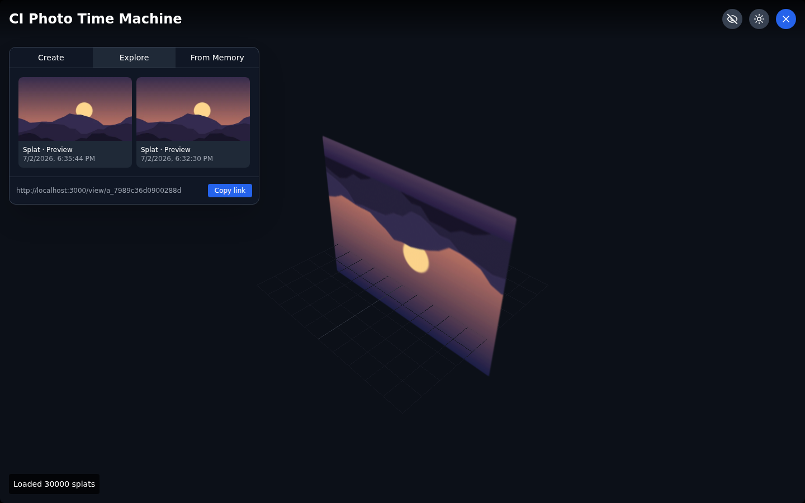
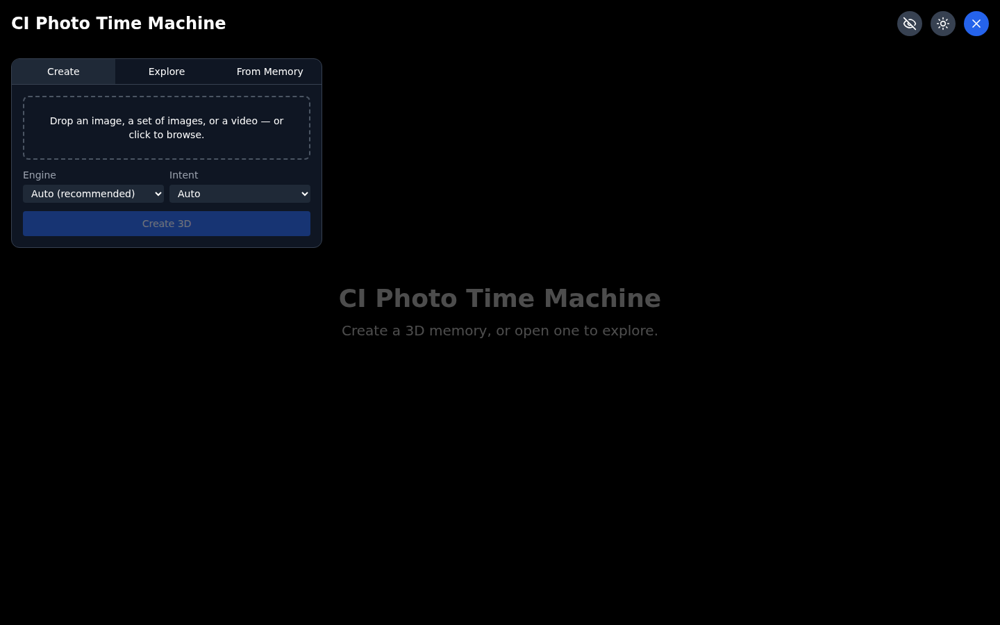
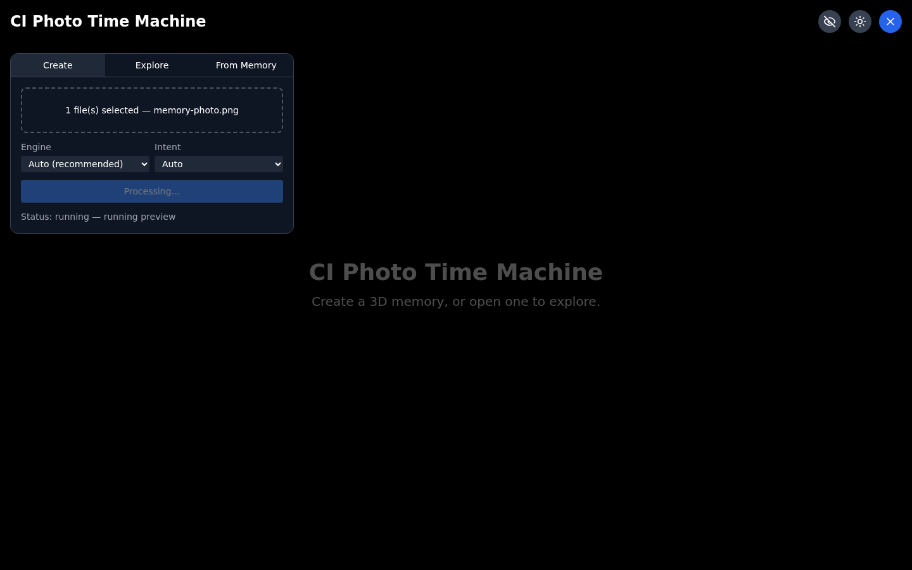
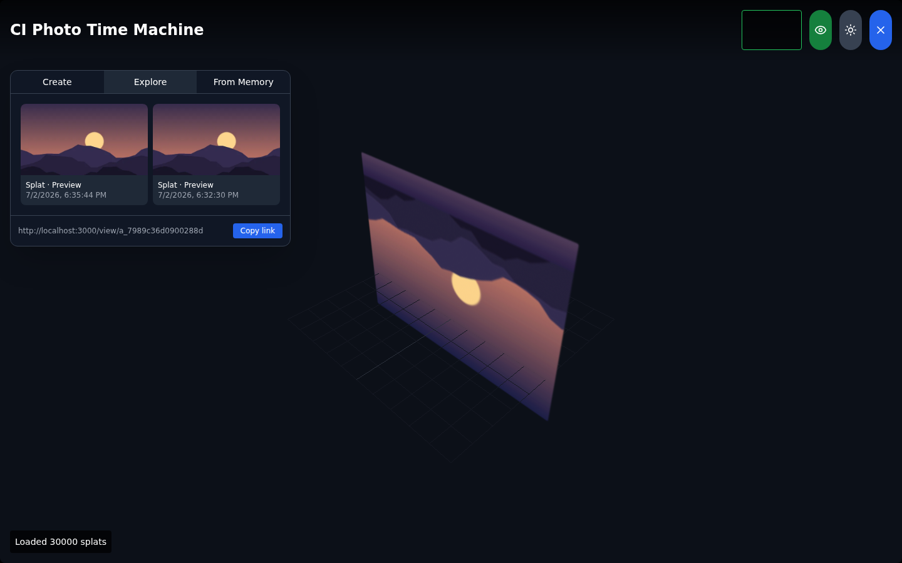
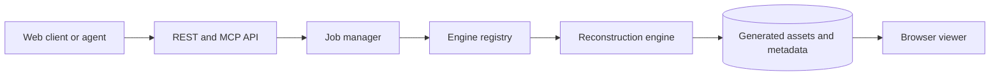
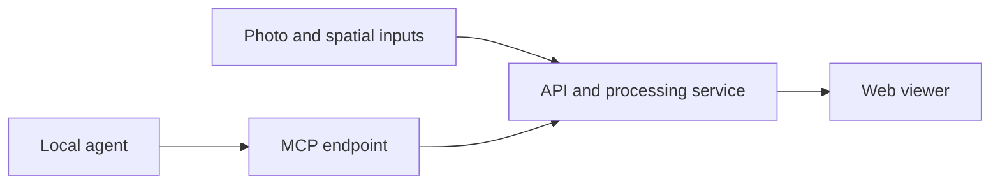

<h1 align="center">CI Photo Time Machine</h1>

<p align="center"><strong>Turn any photo, photo set, or video into a shareable 3D memory: a Gaussian splat or mesh you can explore in a browser or XR.</strong></p>

[](CHANGELOG.md)
[](https://github.com/companionintelligence/CI-Spatial-Photo)
[](LICENSE)
[](https://discord.com/invite/yQp9hwpzAa)

<p align="center"><a href="https://photo.ci.computer">Website</a> · <a href="#documentation">Documentation</a> · <a href="#quick-start-docker">Get started</a> · <a href="https://docs.ci.computer/docs/reference/open-source-systems">Systems map</a></p>

<p align="center">
  <a href="https://photo.ci.computer"></a>
</p>

Part of the [Companion
Intelligence](https://ci.computer) suite: containerized, **MCP‑native**, and wired into
Companion memory and Companion OIDC.

> Point a photo (or a whole video) at it, get back a link. Open the link and step *into* the
> moment with head‑tracked parallax — or drop the 3D model into AR on your phone.


*A real capture: a photo → 30,000-Gaussian splat (spz-compressed), rendered by the web viewer
with its gallery and share link. See the full tour in [docs/UI-GUIDE.md](docs/UI-GUIDE.md).*

- 🧠 **MCP API** — Hermes, OpenClaw, and Claude Code can create and share 3D assets as tools.
- 🧩 **Pluggable engines** — TripoSplat (default), Apple SHARP (research), COLMAP→gsplat
  photogrammetry, and **monocular depth** for images and video, with TRELLIS/Hunyuan mesh
  engines slotting in behind one interface.
- 🎚️ **Pick your model** — the depth engines expose six image checkpoints (Depth Anything V2
  S/B/L, MiDaS DPT Hybrid/Large, Apple Depth Pro) and Video Depth Anything, selectable per job.
  See [docs/DEPTH-ENGINES.md](docs/DEPTH-ENGINES.md).
- 🐳 **Containerized** — one `docker compose up` for the processing server + web viewer.
- 🔐 **Companion‑native** — Companion OIDC auth; created assets are written to CI‑Server /
  Hermes memory so your digital twin remembers them.
- 🕶️ **Web + XR viewer** — [Spark](https://github.com/sparkjsdev/spark)‑powered splat viewer
  with a MediaPipe head‑tracked "magic portal," plus `<model-viewer>` for meshes with native
  mobile AR.


## Features

| Feature | What it provides |
|---|---|
| **Reconstruction jobs** | Route image/video jobs through a registry of pluggable engines. |
| **Agent control** | Expose the same capabilities through REST and MCP. |
| **Asset lifecycle** | Persist job metadata and generated assets for polling and download. |
| **Review** | Render outputs in the browser viewer and optionally connect Memory. |

## Screenshots

<table>
  <tr>
    <td valign="top"><p align="center">Create a new reconstruction job</p></td>
    <td valign="top"><p align="center">Reconstruction job in progress</p></td>
    <td valign="top"><p align="center">Open the generated scene in XR</p></td>
  </tr>
</table>


## How it fits together

The web client or an agent creates a job through REST/MCP; the job manager routes it to a registered engine, stores the output and exposes it to the viewer for review.



## Documentation

| Doc | What's inside |
| --- | --- |
| [**UI Guide**](docs/UI-GUIDE.md) | Every screen, button, and UI element — with real screenshots, behavior/API tables, and mermaid user flows. |
| [**API Reference**](docs/API.md) | REST + MCP surfaces, job state machine, engine routing, data-at-rest layout, configuration, error contract. |
| [**Depth Engines**](docs/DEPTH-ENGINES.md) | `depth-image` / `depth-video`: the model catalog, how to pick one, the licence gates, the back-projection maths, and the limitations. |
| [**Architecture**](docs/ARCHITECTURE.md) | System design: MCP-first core, pluggable engines, Companion OIDC + memory integration. |
| [**Research**](docs/RESEARCH.md) | The engine & viewer trade studies (with licenses) behind every technology choice. |
| [**Bring your own server**](docs/BRING-YOUR-OWN-SERVER.md) | Running the processing server on your own machine and pointing the hosted viewer at it — tunnel, localhost, ci-hub, or fully local — and what each costs you in a browser. |
| [**Deploy (Cloudflare)**](docs/DEPLOY-CLOUDFLARE.md) | How `photo.ci.computer` is put together: the static Worker, DNS, and the origin settings that are easy to miss. |
| [**Changelog**](CHANGELOG.md) | Release notes; current release **2.0.0**. |

## Why this exists / what changed

This project began as a fork of Apple's **SHARP** (single‑image → 3D Gaussian Splatting) with a
Flask + React viewer. Reimagined for the Companion suite, it becomes a proper **3D processing
service**: agent‑drivable over MCP, engine‑agnostic, containerized, and authenticated.

A key reason for the redesign: **SHARP's model weights are licensed for non‑commercial research
only** (`LICENSE_MODEL`). The default engine is now **TripoSplat** (MIT — code *and* weights),
with SHARP kept as an optional, clearly labeled research/scene engine. Full trade study in
[`docs/RESEARCH.md`](docs/RESEARCH.md); system design in [`docs/ARCHITECTURE.md`](docs/ARCHITECTURE.md).

## Quick start (Docker)

```bash
cp .env.example .env      # set PUBLIC_BASE_URL, Companion OIDC + memory (optional)
docker compose up --build
# Viewer:  http://localhost:3000
# API:     http://localhost:8000/api/v1   (docs at /docs)
# MCP:     http://localhost:8000/mcp
```

For **local hacking without auth**, set `AUTH_DISABLED=1` (default in `.env.example`).

## Run the server directly (dev)

```bash
cd server
pip install -e .
uvicorn app.main:app --reload --port 8000
```

The API, MCP surface, input router, auth, and memory client all run **without a GPU**. Engine
*inference* (TripoSplat/SHARP/photogrammetry) needs a CUDA GPU and downloaded weights; without
them the API still works and engines return a clear "GPU/weights required" error.

The **depth engines are the exception** — they run usefully on CPU, and are one optional extra
away:

```bash
pip install -e '.[depth]'    # torch + torchvision + transformers; CPU/MPS/CUDA all work
curl -F files=@photo.jpg -F engine=depth-image localhost:8000/api/v1/jobs
```

Weights (~100 MB for the default Depth Anything V2 Small) download on first use. `torch` is
deliberately *not* a base dependency: without the extra the two depth engines simply report
`available: false` with the install command in `unavailable_reason`, and everything else works.

## Using it

### From the web
1. Open the viewer, drop in an image, a set of images, or a video.
2. The server classifies the input, routes it to an engine, and runs the job.
3. When it finishes, the asset loads in the viewer and you get a **share link**
   (`/view/:assetId`). Enable XR for the head‑tracked portal.

### From an agent (MCP)
Point your Companion agent at `http://<host>:8000/mcp`. Tools:
`list_engines`, `image_to_3d`, `media_to_3d`, `get_job`, `list_assets`, `get_asset`,
`get_share_url`. Example intent: _"make a 3D model of the photo I just shared and send me the
link"_ → `image_to_3d` → poll `get_job` → `get_share_url`.

## Deployed

The hosted viewer is **[photo.ci.computer](https://photo.ci.computer)** — and it is *only*
the viewer. A Cloudflare Worker serves the static bundle; it holds no data, proxies nothing,
and never sees a photo. On first visit it asks which processing server to use, and that
answer lives in your browser.

So the server runs wherever you want it: on your own machine behind a tunnel, on ci-hub, or
on localhost while you work. **[docs/BRING-YOUR-OWN-SERVER.md](docs/BRING-YOUR-OWN-SERVER.md)**
covers the four ways to be reachable and the browser rules each one runs into.

```bash
npm run deploy             # build the viewer + publish the Worker
npm run deploy:staging     # the same thing on workers.dev, domain untouched
```

Deployment itself: [`docs/DEPLOY-CLOUDFLARE.md`](docs/DEPLOY-CLOUDFLARE.md).

## Repository layout

```
server/                 FastAPI 3D processing server + MCP + engines (the new core)
  app/
    engines/            Engine protocol, registry/router, TripoSplat/SHARP/photogrammetry,
                        depth-image/depth-video + the depth model catalog
    main.py routes.py mcp_server.py jobs.py storage.py memory.py auth.py models.py config.py
web-server/client/      React + Three.js + Spark web viewer (kept, evolved: /view/:id, meshes)
src/sharp/              Apple SHARP engine (bundled; research‑licensed weights)
docs/                   UI-GUIDE.md, API.md, ARCHITECTURE.md, RESEARCH.md + screenshots
worker/ wrangler.toml   Cloudflare Worker behind photo.ci.computer (viewer + API proxy)
companion-app.json      Companion Hub / Marketplace manifest
docker-compose.yml      Viewer + server stack
.claude/                SessionStart hook for Claude Code on the web (see CLAUDE.md)
.github/workflows/      CI: server tests + client build; gated Cloudflare deploy
```

## Configuration

| Env var | Purpose | Default |
| --- | --- | --- |
| `PUBLIC_BASE_URL` | Base URL used to build share links | `http://localhost:3000` |
| `AUTH_DISABLED` | Disable Companion OIDC (local dev) | `1` in `.env.example` |
| `COMPANION_OIDC_ISSUER` | OIDC issuer for token verification | — |
| `COMPANION_OIDC_AUDIENCE` | Expected token audience | — |
| `CI_MEMORY_MCP_URL` | Companion memory MCP endpoint (CI‑Server/Hermes) | — (memory off) |
| `DEFAULT_ENGINE` | Engine when none requested | `triposplat` |
| `SHARP_ENABLE_RESEARCH` | Enable the non‑commercial SHARP engine | `0` |
| `DEPTH_MODEL` / `DEPTH_VIDEO_MODEL` | Default checkpoint for the depth engines | `depth-anything-v2-small` |
| `DEPTH_ALLOW_NONCOMMERCIAL` | Unlock the CC‑BY‑NC / Apple‑research depth weights | `0` |
| `DEPTH_AUTO_ROUTE` | Let the depth engines join automatic routing | `0` |
| `MCP_ALLOWED_HOSTS` | Hostnames `/mcp` may be reached by, behind a proxy | — (loopback only) |
| `REACT_APP_API_BASE` | *Viewer* build-time server address. Unset ships a bundle that asks | — (asks on first run) |
| `ASSET_DIR` | Where assets/jobs are persisted | `./data/assets` |

The depth engines have several more tuning knobs (field of view, depth range, splat budget,
frame sampling) — see [docs/DEPTH-ENGINES.md](docs/DEPTH-ENGINES.md#configuration).

## Testing

```bash
cd server && pytest          # router, job lifecycle, API contract, spz round-trip (no GPU)
cd web-server/client && npm run build
```

Both run in CI on every push/PR (`.github/workflows/ci.yml`). The `.spz` pipeline is
additionally validated end-to-end in a real browser: the screenshots in the UI guide come from
a live session where the viewer fetched and rendered the server's spz output.

<!-- companion-hub-readme-deep-review -->

## Service endpoints

| Surface | Default local address | Purpose |
|---|---|---|
| Viewer | `http://localhost:3000` | Browse the photo/spatial collection |
| REST API | `http://localhost:8000/api/v1` | Programmatic access; interactive docs at `/docs` |
| MCP | `http://localhost:8000/mcp` | Agent-facing tool interface |



Bind or publish these endpoints only on a network you trust. The Docker quick start and direct development-server instructions above describe the supported local workflows.

## Credits & licensing

Built on the shoulders of open 3D reconstruction work — see [`docs/RESEARCH.md`](docs/RESEARCH.md)
for the full list and [`ACKNOWLEDGEMENTS`](ACKNOWLEDGEMENTS). The bundled **SHARP** model and code
are © Apple Inc. under the Apple ML Research Model License (`LICENSE_MODEL`, **non‑commercial**)
and Apple sample‑code `LICENSE`. **TripoSplat** is MIT. The splat viewer is powered by
[**Spark**](https://github.com/sparkjsdev/spark) (MIT, World Labs). Verify each engine's license
before commercial deployment.
