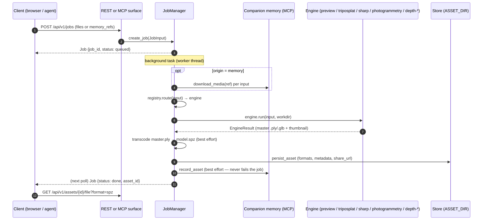
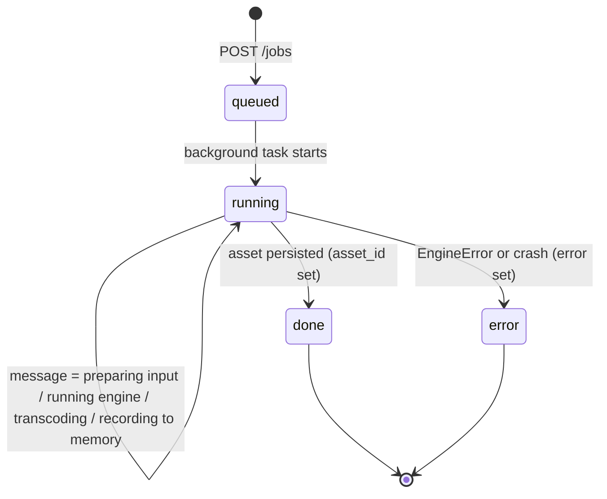
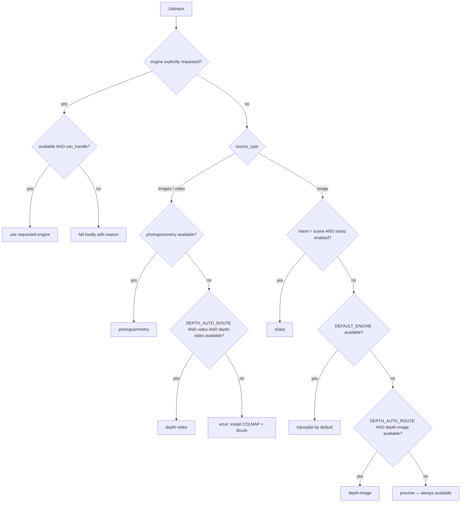
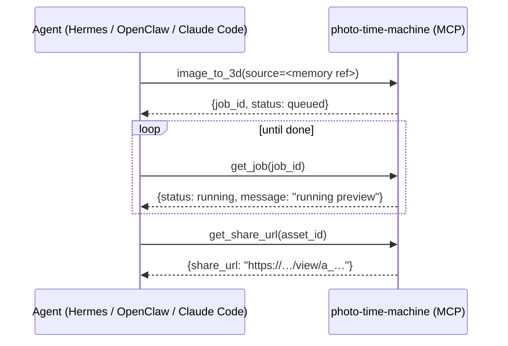

# API Reference — REST & MCP

Technical reference for the CI Photo Time Machine processing server. The browser talks to the
**REST API**; Companion agents (Hermes, OpenClaw, Claude Code) talk to the **MCP server**. Both
are thin surfaces over one shared core (job manager → engine registry → asset store), so they
expose identical capabilities.

- Interactive OpenAPI docs: `http://<server>:8000/docs` (auto-generated by FastAPI)
- MCP endpoint: `http://<server>:8000/mcp` (streamable HTTP transport)
- Liveness: `GET /healthz` → `{"status": "ok", "version": "2.0.0"}`

## Authentication

All `/api/v1/*` routes require a **Companion OIDC bearer token** unless `AUTH_DISABLED=1`.

```
Authorization: Bearer <access token>
```

Verification is standard OIDC: the server fetches `<COMPANION_OIDC_ISSUER>/.well-known/openid-configuration`,
resolves the JWKS, and validates signature + audience (`COMPANION_OIDC_AUDIENCE`). The token's
`email` (fallback `sub`) becomes the **owner key** that scopes jobs and asset listings. With
`AUTH_DISABLED=1` every request runs as the local principal `dev@local`.
Implementation: [`server/app/auth.py`](../server/app/auth.py).

## The processing model



### Job lifecycle



Poll `GET /api/v1/jobs/{job_id}` (the web client polls every 1.5 s). Terminal states: `done`
(with `asset_id`) and `error` (with `error` text). The `message` field is a human-readable
progress note.

### Engine routing



`DEPTH_AUTO_ROUTE` defaults to `0`, so **automatic routing is unchanged** from 2.0.0: installing
the optional `[depth]` extra must not silently move which engine processes existing uploads.
Set `DEFAULT_ENGINE=depth-image` or pass `engine=` per job to reach the depth engines without
the flag.

Implementation: [`server/app/engines/registry.py`](../server/app/engines/registry.py).
Depth engine details: [`DEPTH-ENGINES.md`](./DEPTH-ENGINES.md).

## REST endpoints

Base path: `/api/v1`. All responses are JSON unless noted.

### `POST /jobs` — create a processing job

`multipart/form-data`:

| Field | Type | Required | Description |
| --- | --- | --- | --- |
| `files` | file[] | one of files/memory_refs | One image → single-image path; several images or one video → photogrammetry. |
| `memory_refs` | JSON string array | one of files/memory_refs | Companion-memory refs (or URLs); media is downloaded server-side before the engine runs. |
| `engine` | string | no | Force a specific engine (`preview`, `triposplat`, `sharp`, `photogrammetry`, `depth-image`, `depth-video`). Fails loudly if unavailable. Also accepts the `"<engine>:<model>"` shorthand. |
| `model` | string | no | Checkpoint to run *inside* the engine, for engines that offer a choice — see `models[].id` from `GET /engines`. Ignored by single-model engines. Unknown or unusable ids end the job in `error` on its first tick, before any download or inference. |
| `intent` | `auto` \| `object` \| `scene` | no | `object` = full 3D you can orbit; `scene` = monocular portal (routes to SHARP when enabled). Default `auto`. |
| `format` | string | no | Reserved: preferred delivery format. |
| `source_type` | `image` \| `images` \| `video` | no | Override auto-classification (rarely needed). |

`model` is additive and optional; a client that never sends it behaves exactly as before. The
`engine="depth-image:depth-anything-v2-large"` shorthand is equivalent, and exists for callers
that only have an engine field to spend (the MCP tools, a single-select UI). When both are
given, the explicit `model` field wins.

Returns a `Job` (`202`-style; work continues in the background):

```json
{ "job_id": "job_1a2b…", "owner": "dev@local", "status": "queued",
  "engine": null, "message": "queued", "error": null, "asset_id": null,
  "created_at": "…", "updated_at": "…" }
```

Errors: `400` no input provided; `401` bad/missing token (when auth is on).

### `GET /jobs/{job_id}` — poll job status

Returns the `Job`. `404` if unknown **or owned by someone else** (jobs are owner-scoped).

### `GET /assets` — list your assets

`{"assets": [Asset, …]}`, newest first, owner-scoped.

### `GET /assets/{asset_id}` — asset metadata

```json
{
  "asset_id": "a_9f2c…",
  "owner": "dev@local",
  "kind": "splat",
  "engine": "preview",
  "engine_model": null,
  "source_type": "image",
  "source_origin": "upload",
  "source_filenames": ["memory-photo.png"],
  "temporal": false,
  "formats": { "ply": "master.ply", "spz": "model.spz" },
  "thumbnail": "thumb.webp",
  "share_url": "http://localhost:3000/view/a_9f2c…",
  "created_at": "2026-07-02T18:00:00Z",
  "tags": ["3d", "splat", "preview"],
  "memory_id": null
}
```

`engine_model` (added alongside the depth engines, `null` for single-model engines) records the
checkpoint that produced the asset. "Made with `depth-image`" is not reproducible information:
the Small and Large Depth Anything checkpoints give visibly different geometry from the same
photo. The id also appears in `tags`.

Note: asset *metadata* reads are not owner-restricted — that is what makes `/view/:assetId`
share links work for recipients. Treat asset ids as unguessable capability URLs.

### `GET /assets/{asset_id}/file?format=…` — download an artifact

Streams the artifact (`ply`, `spz`, `glb`, …). Without `format`, serves the first available.
`404` if the format doesn't exist for this asset.

### `GET /assets/{asset_id}/thumbnail` — preview image (`image/webp`)

### `GET /engines` — engine capability matrix

`{"engines": [EngineCapabilities, …]}` — one entry per registered engine:

| Field | Meaning |
| --- | --- |
| `name` / `description` | Engine id and human description. |
| `inputs` | Which `source_type`s it accepts (`image`, `images`, `video`). |
| `intents` | Which intents it serves (`auto`, `object`, `scene`). |
| `output_kind` / `output_formats` | `splat` or `mesh`, master formats produced. |
| `commercial` | Whether the license permits product use (SHARP: `false`). |
| `requires_gpu` | Whether inference needs CUDA. |
| `license` | License summary string. |
| `available` / `unavailable_reason` | Live availability (runtime/weights/flags present?) with a fix-it hint. |
| `models` | **New, optional.** Selectable checkpoints inside this engine. `[]` for single-model engines — every engine that predates the depth backends. |
| `default_model` | **New, optional.** The `models[].id` a job with no `model` field would run, or `null`. |

Both additions are defaulted, so the payload an older client parses is unchanged. Each `models`
entry:

| Field | Meaning |
| --- | --- |
| `id` | The value to send as `model` on `POST /jobs`. |
| `label` / `description` | Human-readable name and what it is good for. |
| `license` / `commercial` | Per-checkpoint licence; `commercial: false` weights are gated behind `DEPTH_ALLOW_NONCOMMERCIAL=1`. |
| `requires_gpu` | Whether a GPU is strongly recommended for this size. |
| `temporal` | The checkpoint is temporally consistent by construction (video models). |
| `approx_download_mb` | Size of the first-use download — warn the user before a 1.3 GB pull. |
| `weights_cached` | A local snapshot already exists, so selecting it downloads nothing. |
| `available` / `unavailable_reason` | Per-checkpoint gating. Three independent things can close it — the `[depth]` extra missing, the licence gate, or uncached weights with downloads disabled — and the reason names which. |

Engine-level `available` is true when **any** checkpoint is usable, which is why a
licence-gated Large entry does not make the engine look broken.

### `GET /memory/media?type=image|video` — browse Companion memory

Lists the caller's photos/videos from the configured CI memory MCP server (`{"media": []}` when
memory isn't configured). Each item: `{ref, kind, title?, thumbnail_url?}` — pass `ref` back to
`POST /jobs` as `memory_refs` to splat it.

## MCP tools

Mount: `http://<server>:8000/mcp` (streamable HTTP). Server name: `photo-time-machine`.
Implementation: [`server/app/mcp_server.py`](../server/app/mcp_server.py).

| Tool | Args | Returns | Notes |
| --- | --- | --- | --- |
| `list_engines` | — | `EngineCapabilities[]` | Same data as `GET /engines`. |
| `image_to_3d` | `source` (URL or memory ref), `intent?`, `engine?` | `Job` | Single image → 3D. Poll with `get_job`. |
| `media_to_3d` | `sources` (URLs/refs), `intent?`, `engine?` | `Job` | Multi-image or video → reconstructed scene. |
| `get_job` | `job_id` | `Job` | `asset_id` populated when `status == "done"`. |
| `list_assets` | — | `Asset[]` | Assets with share URLs. |
| `get_asset` | `asset_id` | `Asset` | Full metadata. |
| `get_share_url` | `asset_id` | `{asset_id, share_url}` | The `/view/:assetId` link. |

The MCP tools have no separate `model` argument — pass the shorthand through `engine` instead:
`image_to_3d(source=…, engine="depth-image:depth-anything-v2-large")`. `list_engines` returns
the same `models` array as `GET /engines`, so an agent can discover the valid ids first.

Agent recipe — "turn this photo into 3D and give me a link":



## Data at rest

```
ASSET_DIR/
├── jobs/<job_id>.json              # Job records
├── assets/<asset_id>/
│   ├── metadata.json               # Asset record (see above)
│   ├── master.ply | master.glb     # Engine's master artifact
│   ├── model.spz                   # Compressed delivery (auto-transcoded)
│   └── thumb.webp                  # Thumbnail
└── _uploads/, _work/               # Staging and per-job workdirs
```

Single-process, filesystem-backed by design (`server/app/storage.py` is the seam for a future
DB + object store).

## Configuration

Every setting is an environment variable (see [`.env.example`](../.env.example)):

| Variable | Default | Effect |
| --- | --- | --- |
| `PUBLIC_BASE_URL` | `http://localhost:3000` | Base for `share_url` generation. |
| `AUTH_DISABLED` | `1` | `1` = local dev principal; `0` = require Companion OIDC. |
| `COMPANION_OIDC_ISSUER` / `COMPANION_OIDC_AUDIENCE` | — | OIDC verification parameters. |
| `CI_MEMORY_MCP_URL` | — | Companion memory MCP endpoint; empty disables memory. |
| `CI_MEMORY_WRITE_TOOL` | `create_memory` | Memory-write tool name (deployment-specific). |
| `DEFAULT_ENGINE` | `triposplat` | Router default for single images. |
| `SHARP_ENABLE_RESEARCH` | `0` | Gate for the non-commercial SHARP engine. |
| `MODEL_WEIGHTS_DIR` | `/models` | Where engine weights are mounted; also searched for cached HuggingFace snapshots. |
| `ASSET_DIR` | `./data/assets` | Persistence root. |
| `TRIPOSPLAT_CMD` / `BRUSH_CMD` | `triposplat` / `brush` | Engine runtime binaries (subprocess adapters). |
| `DEPTH_MODEL` / `DEPTH_VIDEO_MODEL` | `depth-anything-v2-small` | Default checkpoint per depth engine. |
| `DEPTH_ALLOW_NONCOMMERCIAL` | `0` | Unlock CC-BY-NC / Apple-research depth weights. |
| `DEPTH_AUTO_ROUTE` | `0` | Let the depth engines join automatic routing. |
| `DEPTH_FOV_DEG` / `DEPTH_RANGE` | `60` / `8` | Assumed field of view; far:near depth ratio. |
| `DEPTH_MAX_POINTS` / `DEPTH_EDGE_DROP_PERCENT` | `400000` / `2` | Gaussian budget; occlusion-edge rejection. |
| `DEPTH_VIDEO_FPS` / `DEPTH_VIDEO_MAX_FRAMES` | `2` / `32` | Frame sampling for `depth-video`. |
| `VIDEO_DEPTH_CMD` | `video-depth-anything` | Binary for the external video-depth adapter. |
| `HF_HUB_OFFLINE` / `PTM_NO_DOWNLOAD` | — | Forbid weight downloads; uncached checkpoints then report unavailable instead of hanging on a fetch. |

## Error handling contract

- Engines raise `EngineError` with an actionable message (e.g. *"TripoSplat CLI not found.
  Install TripoSplat and its weights in the engine image"*) → job ends `status: "error"`.
- Transcode and memory writes are **best-effort**: their failure never fails a job.
- Unknown/foreign `job_id` → `404`; requesting an unavailable engine → routed error at job
  runtime with the engine's `unavailable_reason`.
