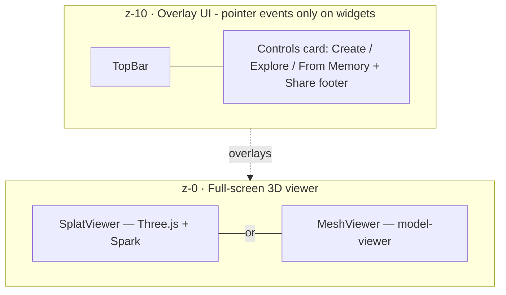
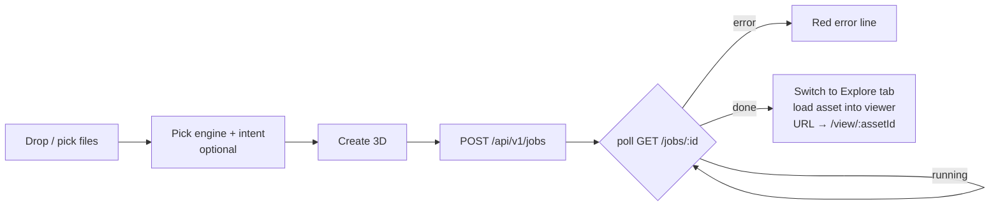
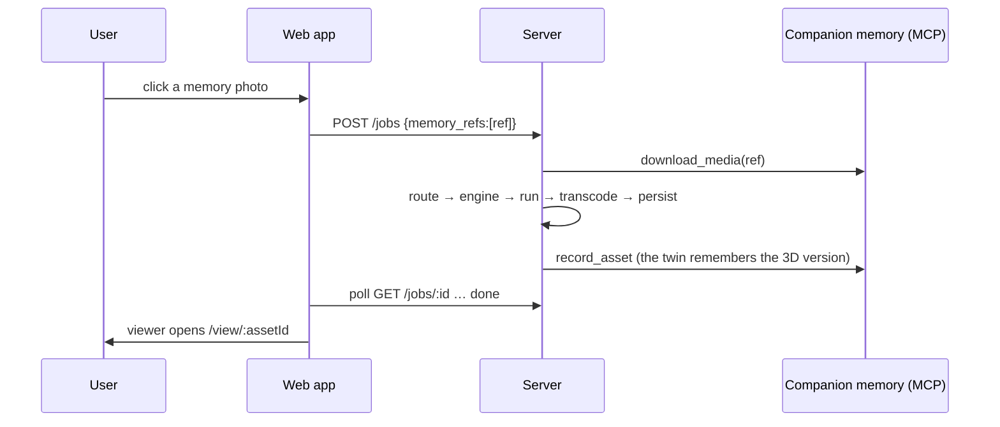
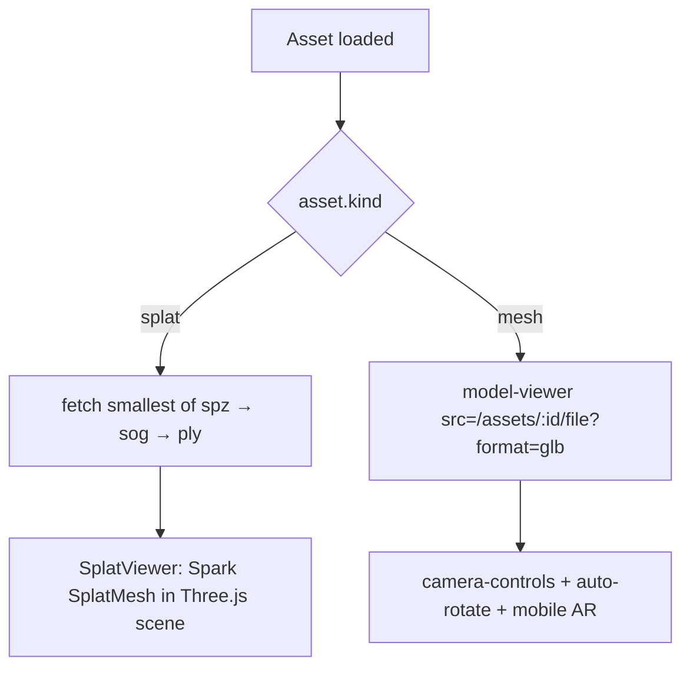
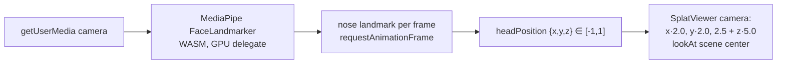
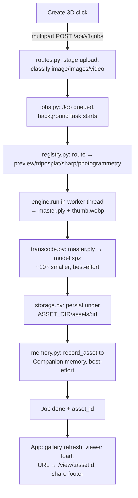

# UI Guide — every screen, button, and element

A complete functional + technical tour of the CI Photo Time Machine web app. Screenshots are
captured from the real app driving the real server (Preview engine, no GPU). For the API
behind each interaction see [`API.md`](API.md); for system design see
[`ARCHITECTURE.md`](ARCHITECTURE.md).

The app is a single-page React application (`web-server/client/`) with three layers:



| Route | What renders | Source |
| --- | --- | --- |
| `/` | Empty viewer + controls card on the **Create** tab | `App.tsx` |
| `/view/:assetId` | The shared asset loads straight into the viewer (deep link) | `App.tsx` → `parseViewId()` |

---

## 1. App shell & top bar


The top bar is always visible; the controls card can be hidden for an immersive view.

### Top bar elements (`components/TopBar.tsx`)

| # | Element | Type | Behavior | Technical notes |
| --- | --- | --- | --- | --- |
| 1 | **"CI Photo Time Machine"** | Title | Static branding | `<h1>`, drop-shadow over the viewer |
| 2 | **Webcam preview** | Canvas (only in XR mode) | Mirrored live webcam with a green face-tracking dot | 160×120 canvas; dot drawn at the tracked nose position; green border signals tracking active |
| 3 | **XR toggle** | Icon button (eye / eye-off) | Enables/disables head-tracked parallax | Gray = off, **green = on**. Toggles `useHeadTracking(enabled)`: requests `getUserMedia` camera, loads MediaPipe FaceLandmarker (WASM from CDN), streams `headPosition {x,y,z}` into the viewer camera each frame |
| 4 | **Theme toggle** | Icon button (sun / moon) | Switches light/dark text scheme | Local state only; viewer canvas is always dark |
| 5 | **Controls toggle** | Icon button (X / gear) | Shows/hides the controls card | Blue button. X when visible, gear when hidden (see [§7](#7-immersive-mode-controls-hidden)) |

### Controls card

A floating, scrollable card (max 60% viewport height) with three tabs and a contextual share
footer. Tab buttons highlight the active tab with a darker background.

| Tab | Purpose | Backing component |
| --- | --- | --- |
| **Create** | Upload media → create a 3D asset | `CreatePanel.tsx` |
| **Explore** | Browse and reopen your created assets | `Gallery.tsx` |
| **From Memory** | Turn photos/videos from Companion memory into splats | `MemoryPicker.tsx` |

---

## 2. Create tab

### Empty state


| Element | Type | Behavior | API |
| --- | --- | --- | --- |
| **Dropzone** | Drag-and-drop area + click-to-browse | Accepts `image/*` and `video/*`, multiple files. Blue highlight while dragging. Shows the selected file names once chosen | — (`react-dropzone`) |
| **Engine** select | Dropdown | `Auto (recommended)` + one option per engine; engines whose runtime/weights are missing render **disabled** with "(unavailable)" | Populated from `GET /api/v1/engines` on mount |
| **Intent** select | Dropdown | `Auto` / `Object (full 3D)` / `Scene (portal)` — biases the router: *object* → generation engines, *scene* → SHARP (if enabled) | Sent as `intent` form field |
| **Create 3D** | Primary button | Disabled until ≥1 file is selected; label flips to `Processing…` while a job runs | `POST /api/v1/jobs` then polls `GET /jobs/:id` every 1.5 s |
| **Status line** | Text | Live job progress: `Status: running — running preview` | Mirrors `Job.status` + `Job.message` |
| **Error line** | Red text | Engine/validation errors verbatim from the server | Mirrors `Job.error` |

### File selected


### Processing


The button is disabled and shows `Processing…`; the status line updates as the job moves
through `preparing input → running <engine> → transcoding → recording to memory → done`.



On success the app automatically: switches to **Explore**, refreshes the gallery, loads the new
asset into the viewer, rewrites the URL to `/view/:assetId` (so the address bar *is* the share
link), and reveals the share footer.

---

## 3. Explore tab (gallery)


| Element | Type | Behavior | API |
| --- | --- | --- | --- |
| **Asset card** | Button (2-column grid) | Click loads that asset into the viewer and updates the URL to its share link. Hover: blue ring + subtle thumbnail zoom | `GET /api/v1/assets` for the list; click → `GET /assets/:id` + file download |
| — thumbnail | Image (16:9) | WebP preview generated at creation; falls back to a kind label (`splat`/`mesh`) if absent | `GET /assets/:id/thumbnail` |
| — caption | Text | `Kind · Engine` (e.g. *Splat · Preview*) + local creation time | From asset metadata |
| **Empty state** | Text | "No 3D memories yet — create one above." | — |
| **Error state** | Red text | "Could not load assets: …" (e.g. server down) | — |

### Share footer (visible whenever an asset is loaded)

| Element | Type | Behavior |
| --- | --- | --- |
| **Share URL** | Truncated text | The asset's public `share_url` (`PUBLIC_BASE_URL` + `/view/:assetId`) |
| **Copy link** | Button | Copies the share URL to the clipboard (`navigator.clipboard`) |

---

## 4. From Memory tab


Browse your Companion memory (CI-Server / Hermes) and turn a photo or video into a splat
without re-uploading it — the server pulls the media directly from memory.

| Element | Type | Behavior | API |
| --- | --- | --- | --- |
| **Photos / Videos** | Toggle buttons | Switches the media type being browsed (active = blue) | `GET /api/v1/memory/media?type=image\|video` |
| **Media grid** | Buttons (3-col, square) | Click = create a 3D asset from that memory item; then identical flow to Create | `POST /jobs` with `memory_refs=[ref]` |
| **Status note** | Text | *"Companion memory is not connected."* when `CI_MEMORY_MCP_URL` is unset/unreachable (shown above); *"No media in Companion memory…"* when connected but empty | — |
| **Job status** | Text | Same live `status — message` line as Create | `GET /jobs/:id` polling |



---

## 5. The 3D viewer

### Splat viewer (`components/SplatViewer.tsx` — Three.js + Spark)


| Element / control | Behavior | Technical notes |
| --- | --- | --- |
| **Orbit** (drag) | Rotate around the focus point | `OrbitControls`, damped (`dampingFactor 0.08`) |
| **Zoom** (wheel/pinch) | Dolly in/out | `zoomSpeed 0.6` |
| **Pan** (right-drag / two-finger) | Translate the target | `panSpeed 0.6` |
| **Status badge** (bottom-left) | `Loading…` → `Loaded N splats`, or a red error | Bottom-left so it never collides with the top bar |
| **Reference grid** | 2.5 m ground grid for spatial orientation | `THREE.GridHelper`, positioned below the scene |
| **Format selection** | The viewer downloads the smallest format Spark can parse: **spz → sog → ply** | `viewerSplatFormat()` in `api.ts`; `.spz` is ~10× smaller than `.ply` |
| **Camera framing** | If the PLY carries SHARP camera metadata: exact intrinsics/extrinsics projection (portal-accurate). Otherwise: automatic bounding-box framing | `makeProjectionFromIntrinsics` / `getBoundingBox` paths |
| **Coordinate handling** | ml-sharp/3DGS assets are OpenCV-convention; the viewer applies a CV→GL axis flip | `makeAxisFlipCvToGl()` |

### Mesh viewer (`components/MeshViewer.tsx` — `<model-viewer>`)

Used automatically when `asset.kind === "mesh"` (`.glb`). Camera orbit + auto-rotate +
**native mobile AR** (Scene Viewer on Android, Quick Look on iOS) via the `ar` attribute. The
asset thumbnail doubles as the loading poster. Loaded lazily so splat-only sessions never pay
for it.



---

## 6. XR mode (head-tracked "magic portal")


Click the **eye** button to enable XR. The button turns green and a mirrored webcam preview
appears beside it.

| Element | Behavior |
| --- | --- |
| **Webcam preview** | Live mirrored feed (green border). A green dot marks the tracked nose position — instant feedback that tracking is locked |
| **Viewer camera** | Your head position drives the camera: move left/right/up/down for parallax, lean in/out to dolly — the screen becomes a window into the scene |
| **Eye button (green)** | Click again to disable: camera stream stops, tracking model unloads, orbit controls take back over |

Technical pipeline (`hooks/useHeadTracking.ts`):



Privacy note: all tracking runs **in the browser** — webcam frames never leave the device; the
only network fetch is the MediaPipe WASM/model bundle from the CDN on first enable.

---

## 7. Immersive mode (controls hidden)


The **X** button collapses the entire controls card; only the top bar remains. The button
becomes a **gear** — click to bring the controls back. Ideal for XR portal demos and
screenshots.

---

## 8. Sharing & the `/view/:assetId` deep link


Every asset's address is a capability URL: `PUBLIC_BASE_URL/view/<asset_id>`.

1. **Copy link** (share footer) puts it on the clipboard.
2. A recipient opening it gets the full viewer with that asset pre-loaded (the SPA serves
   `index.html` for `/view/*`; the app fetches metadata + the smallest artifact and renders).
3. The recipient can orbit, enable XR, and explore — no login required when the server allows
   anonymous reads (`AUTH_DISABLED=1`); with Companion OIDC enabled, viewers authenticate first.

```mermaid
sequenceDiagram
    participant R as Recipient browser
    participant V as Viewer host (SPA)
    participant S as Processing server
    R->>V: GET /view/a_7989c36d…
    V-->>R: index.html (SPA fallback route)
    R->>S: GET /api/v1/assets/a_7989c36d…
    S-->>R: metadata {kind, formats, thumbnail}
    R->>S: GET /assets/a_7989c36d…/file?format=spz
    S-->>R: 3D asset (compressed)
    R->>R: Spark renders; orbit/XR available
```

---

## 9. API explorer

`http://<server>:8000/docs` — auto-generated OpenAPI UI for the REST surface: try uploads,
inspect schemas, and download artifacts without the web app. The MCP surface lives at
`/mcp` for Companion agents (see [`API.md`](API.md#mcp-tools)).

---

## Appendix: end-to-end anatomy of one click

What happens between "Create 3D" and a shareable link (all observable in the screenshots
above; every arrow is a file in this repo):


