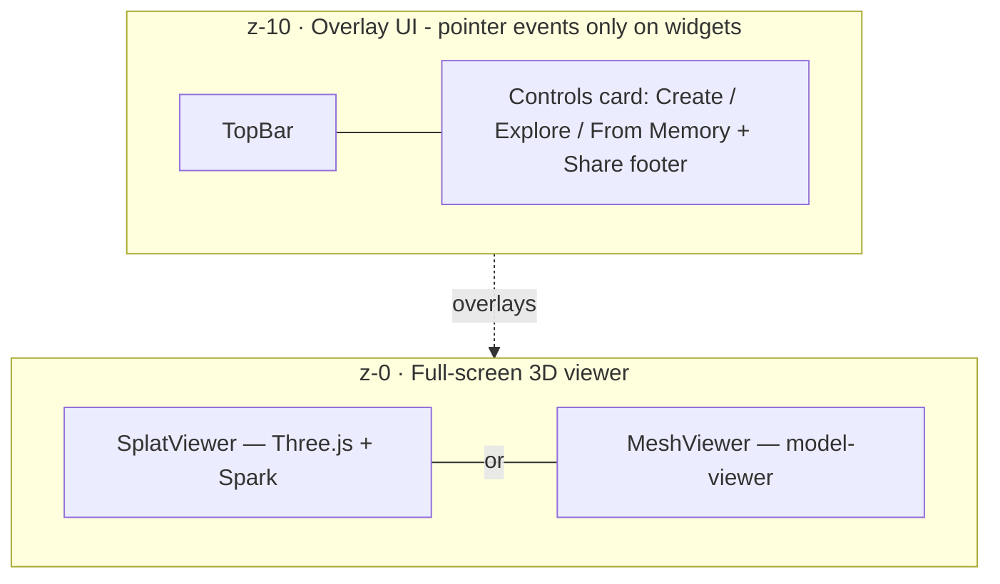
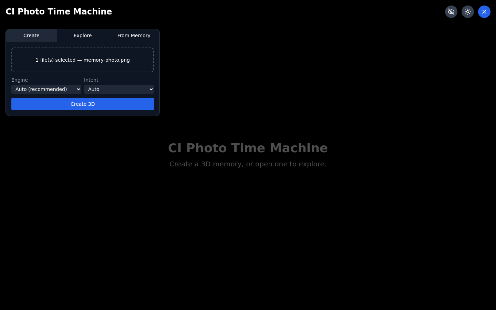
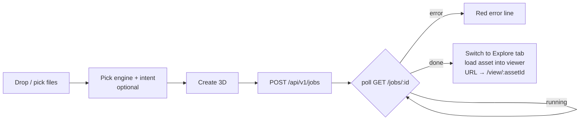
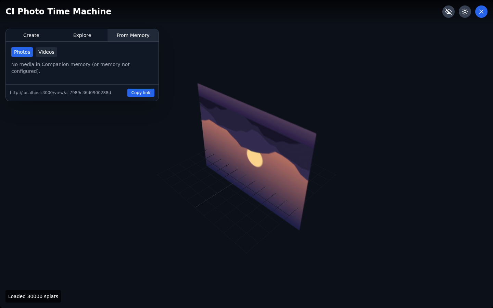
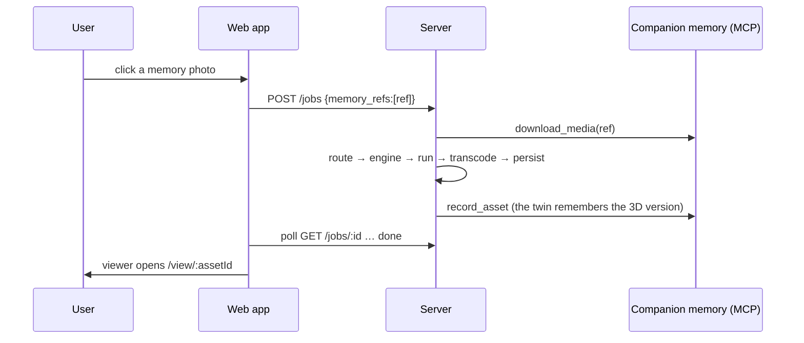
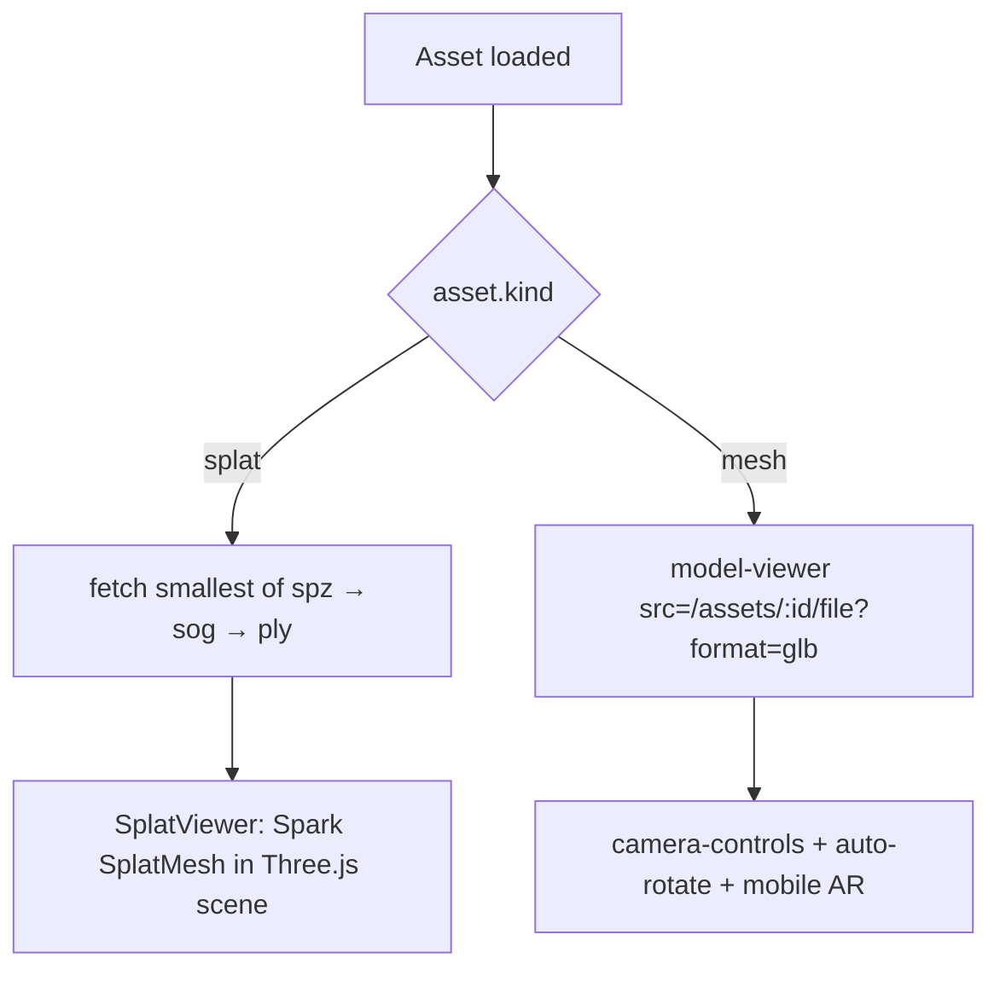
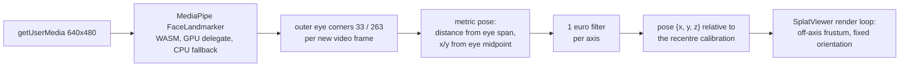
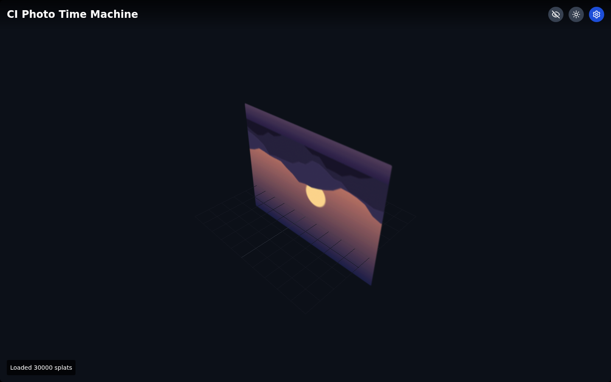
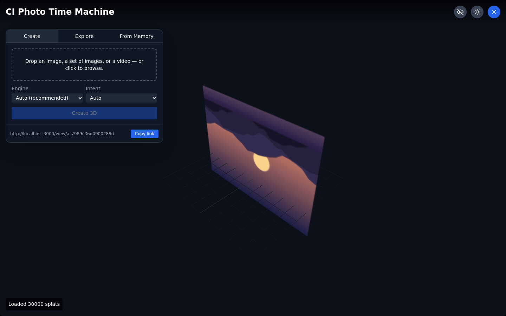
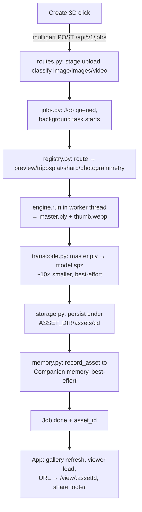

# UI Guide — every screen, button, and element

A complete functional + technical tour of the CI Photo Time Machine web app. Screenshots are
captured from the real app driving the real server (Preview engine, no GPU). For the API
behind each interaction see [`API.md`](API.md); for system design see
[`ARCHITECTURE.md`](ARCHITECTURE.md); for immersive AR and the physical display calibration see
[`AR.md`](AR.md).

The app is a single-page React application (`web-server/client/`) with three layers:



| Route | What renders | Source |
| --- | --- | --- |
| `/` | Empty viewer + controls card on the **Create** tab | `App.tsx` |
| `/view/:assetId` | The shared asset loads straight into the viewer (deep link) | `App.tsx` → `parseViewId()` |

---

## 1. App shell & top bar


The top bar is always visible; the controls card can be hidden for an immersive view.

### Top bar elements (`components/TopBar.tsx`)

| # | Element | Type | Behavior | Technical notes |
| --- | --- | --- | --- | --- |
| 1 | **"Photo Time Machine"** | Title | Static branding | `<h1>`, drop-shadow over the viewer |
| 2 | **XR toggle** | Icon button (eye / eye-off) | Enables/disables the head-tracked magic window | Gray = off, **green = on**. Toggles `useHeadTracking(enabled)`; nothing is downloaded and no camera is requested until this is on (see [§6](#6-xr-mode-the-head-tracked-magic-window)) |
| 3 | **XR panel** | Card (only in XR mode) | Webcam preview, tracking status, **Recentre**, parallax slider, **screen-size calibration** | Drops below the top bar while XR is on. Detailed in [§6](#6-xr-mode-the-head-tracked-magic-window) |
| 4 | **Theme toggle** | Icon button (sun / moon) | Switches light/dark text scheme | Local state only; viewer canvas is always dark |
| 5 | **Controls toggle** | Icon button (X / gear) | Shows/hides the controls card | Blue button. X when visible, gear when hidden (see [§7](#7-immersive-mode-controls-hidden)) |

### Controls card

A floating, scrollable card (max 60% viewport height) with three tabs and a contextual share
footer. Tab buttons highlight the active tab with a darker background.

| Tab | Purpose | Backing component |
| --- | --- | --- |
| **Create** | Upload media → create a 3D asset | `CreatePanel.tsx` |
| **Explore** | Browse and reopen your created assets | `Gallery.tsx` |
| **From Memory** | Turn photos/videos from Companion memory into splats | `MemoryPicker.tsx` |

---

## 2. Create tab

### Empty state


| Element | Type | Behavior | API |
| --- | --- | --- | --- |
| **Dropzone** | Drag-and-drop area + click-to-browse | Accepts `image/*` and `video/*`, multiple files. Blue highlight while dragging. Shows the selected file names once chosen | — (`react-dropzone`) |
| **Engine** select | Dropdown | `Auto (recommended)` + one option per engine. Engines whose runtime/weights are missing are marked `⚠` and stay **selectable**: choosing one shows the server's `unavailable_reason` verbatim and disables Create, rather than hiding an instruction behind a `disabled` option nobody can reach | Populated from `GET /api/v1/engines` on mount |
| **Model** select | Dropdown | Only rendered for an explicitly chosen engine that advertises more than one checkpoint (the depth engines). `Default (<name>)` sends no `model` field and lets the server apply `default_model`; any other option pins that checkpoint. Uncached checkpoints show their download size, and an unavailable one blocks Create with its own reason | Options from `models[]`; sent as the `model` form field |
| **Engine detail** | `<details>` disclosure | Always-visible summary names the engine, tags it `Auto's pick` / `Auto chose`, and prints `GPU · output · licence · commercial` for the checkpoint that will actually run. Expanding lists every engine with its description, per-checkpoint licence and download state, and any `unavailable_reason` | `GET /api/v1/engines` |
| **Intent** select | Dropdown | `Auto` / `Object (full 3D)` / `Scene (portal)` — biases the router: *object* → generation engines, *scene* → SHARP (if enabled) | Sent as `intent` form field |
| **Create 3D** | Primary button | Disabled until ≥1 file is selected; label flips to `Processing…` while a job runs | `POST /api/v1/jobs` then polls `GET /jobs/:id` every 1.5 s |
| **Status line** | Text | Live job progress: `Status: running — running preview` | Mirrors `Job.status` + `Job.message` |
| **Error line** | Red text | Engine/validation errors verbatim from the server | Mirrors `Job.error` |

### File selected



### Processing


The button is disabled and shows `Processing…`; the status line updates as the job moves
through `preparing input → running <engine> → transcoding → recording to memory → done`.



On success the app automatically: switches to **Explore**, refreshes the gallery, loads the new
asset into the viewer, rewrites the URL to `/view/:assetId` (so the address bar *is* the share
link), and reveals the share footer.

---

## 3. Explore tab (gallery)


| Element | Type | Behavior | API |
| --- | --- | --- | --- |
| **Asset card** | Button (2-column grid) | Click loads that asset into the viewer and updates the URL to its share link. Hover: blue ring + subtle thumbnail zoom | `GET /api/v1/assets` for the list; click → `GET /assets/:id` + file download |
| — thumbnail | Image (16:9) | WebP preview generated at creation; falls back to a kind label (`splat`/`mesh`) if absent | `GET /assets/:id/thumbnail` |
| — caption | Text | `Kind · Engine` (e.g. *Splat · Preview*) + local creation time | From asset metadata |
| **Empty state** | Text | "No 3D memories yet — create one above." | — |
| **Error state** | Red text | "Could not load assets: …" (e.g. server down) | — |

### Share footer (visible whenever an asset is loaded)

| Element | Type | Behavior |
| --- | --- | --- |
| **Share URL** | Truncated text | The asset's public `share_url` (`PUBLIC_BASE_URL` + `/view/:assetId`) |
| **Copy link** | Button | Copies the share URL to the clipboard (`navigator.clipboard`) |

---

## 4. From Memory tab



Browse your Companion memory (CI-Server / Hermes) and turn a photo or video into a splat
without re-uploading it — the server pulls the media directly from memory.

| Element | Type | Behavior | API |
| --- | --- | --- | --- |
| **Photos / Videos** | Toggle buttons | Switches the media type being browsed (active = blue) | `GET /api/v1/memory/media?type=image\|video` |
| **Media grid** | Buttons (3-col, square) | Click = create a 3D asset from that memory item; then identical flow to Create | `POST /jobs` with `memory_refs=[ref]` |
| **Status note** | Text | *"Companion memory is not connected."* when `CI_MEMORY_MCP_URL` is unset/unreachable (shown above); *"No media in Companion memory…"* when connected but empty | — |
| **Job status** | Text | Same live `status — message` line as Create | `GET /jobs/:id` polling |



---

## 5. The 3D viewer

### Splat viewer (`components/SplatViewer.tsx` — Three.js + Spark)


| Element / control | Behavior | Technical notes |
| --- | --- | --- |
| **Orbit** (drag) | Rotate around the focus point | `OrbitControls`, damped (`dampingFactor 0.08`) |
| **Zoom** (wheel/pinch) | Dolly in/out | `zoomSpeed 0.6` |
| **Pan** (right-drag / two-finger) | Translate the target | `panSpeed 0.6` |
| **Status badge** (bottom-left) | `Loading…` → `Loaded N splats`, or a red error | Bottom-left so it never collides with the top bar |
| **Reference grid** | 2.5 m ground grid for spatial orientation | `THREE.GridHelper`, positioned below the scene |
| **Format selection** | The viewer downloads the smallest format Spark can parse: **spz → sog → ply** | `viewerSplatFormat()` in `api.ts`; `.spz` is ~10× smaller than `.ply` |
| **Camera framing** | If the PLY carries SHARP camera metadata: exact intrinsics/extrinsics projection (portal-accurate). Otherwise: automatic bounding-box framing | `makeProjectionFromIntrinsics` / `getBoundingBox` paths |
| **Coordinate handling** | ml-sharp/3DGS assets are OpenCV-convention; the viewer applies a CV→GL axis flip | `makeAxisFlipCvToGl()` |
| **Head tracking** | While XR is on, orbit/zoom/pan are suspended and the camera is driven by an off-axis frustum instead (see [§6](#6-xr-mode-the-head-tracked-magic-window)). Turning XR off restores the exact pose it left | Only one writer touches the camera per frame; `controls.update()` is not called in XR mode |
| **View in your room** (bottom-right) | Enters immersive AR: the memory stands on your real floor. **Only rendered on a device that confirmed `immersive-ar` support** — Android Chrome, Quest browser — and only once a memory is loaded. On iPhone/iPad a disclosure explains why there is no button instead. See [`AR.md`](AR.md) | `utils/webxrSession.ts` + `utils/arPlacement.ts`; the session runs on this same renderer via `renderer.xr` and `setAnimationLoop` |

### Mesh viewer (`components/MeshViewer.tsx` — `<model-viewer>`)

Used automatically when `asset.kind === "mesh"` (`.glb`). Camera orbit + auto-rotate +
**native mobile AR** (Scene Viewer on Android, Quick Look on iOS) via the `ar` attribute. The
asset thumbnail doubles as the loading poster. Loaded lazily so splat-only sessions never pay
for it.



---

## 6. XR mode (the head-tracked "magic window")


> The screenshot above predates the XR panel described here and shows the older inline preview.
> Re-capture it the next time the shot list is refreshed.

Click the **eye** button to enable XR. The button turns green, the browser asks for the camera,
and a panel drops below the top bar.

**XR is off by default and stays off until this button is pressed.** Nothing is downloaded and
`getUserMedia` is never called before then — which is also what keeps the headless product-video
capture (`video/storyboard.json`, no camera present) working.

### What "magic window" means here

The screen is treated as a fixed pane of glass hanging in the scene, not as a camera you steer.
Move your head and the *projection* becomes asymmetric — the four corners of the glass stay
welded to the four corners of the viewport while everything behind it slides. That is
**off-axis perspective projection** (Robert Kooima, *Generalized Perspective Projection*, 2008),
implemented in `utils/magicWindow.ts`:

```
vr, vu, vn = screen right / up / normal        pa, pb, pc = screen corners
va = pa - eye,  vb = pb - eye,  vc = pc - eye  d  = -dot(vn, va)

left   = dot(vr, va) · near / d     right = dot(vr, vb) · near / d
bottom = dot(vu, va) · near / d     top   = dot(vu, vc) · near / d
```

The camera's *orientation* never changes while XR is on — a window does not turn to follow you.
`magicWindow.test.ts` asserts the corner-pinning property directly, and asserts that the
"move the camera and `lookAt` the subject" construction fails it.

The glass is placed 55% of the way from the orbit camera to its target
(`WINDOW_DEPTH_FRACTION` in `SplatViewer.tsx`), so the whole subject sits *behind* it like a
diorama in a box. That matters for the default `preview` engine, which produces a flat plane of
Gaussians: with the glass on the subject plane there would be no parallax at all. At the
calibration pose the projection is bit-identical to the ordinary orbit view, so switching XR on
never re-frames the memory.

#### Relative vs. calibrated

Out of the box the window is *relative*: the parallax assumes the physical screen subtends
exactly the virtual camera's field of view, which is self-consistent but not true of any
particular display — a 13" laptop and a 27" monitor move the scene by the same amount for the
same head movement. Entering the panel diagonal (**Screen size**, below) makes it *calibrated
1:1*: the camera dollies back by `A = tan(θ_virtual)/tan(θ_physical)` and the lens narrows by
`1/A`, which leaves the framing at the target plane identical while making head movement
life-sized. The full derivation, the known error cases, and why the two projection matrices are
deliberately **not** equal are in [`AR.md`](AR.md#2-display-calibration).

### The XR panel

| Element | Behavior |
| --- | --- |
| **Webcam preview** | Live mirrored feed. A green reticle marks the eye midpoint the geometry actually uses. The border colour follows the status |
| **Status** | `Starting camera…` (sky) → `Looking for your face` (amber) → `Tracking` (green); `Camera blocked` / `Camera unavailable` (red) with the reason spelled out |
| **Recentre** | Treats your current head position and distance as dead centre. Enabled only while tracking. Use it after you move your chair, or if the view feels off-axis at rest |
| **Parallax** | Sensitivity, 0.25×–3×, default 1.5×. **1.00× is physically true to life**; above it the parallax is deliberately exaggerated, which most people prefer at a laptop where head movement is small |
| **Screen size** | The display's diagonal in inches — the number printed on the box. Optional, persisted (`ptm:display-diagonal-inches`), and applied as you type. The badge beside it says which projection is actually live: **calibrated 1:1** or **relative**. Anything outside 4–150 inches is refused inline *and* clears the stored value, so the badge can never claim a calibration the viewer is not using. There is no browser API for physical display size, which is why the app has to ask |
| **Eye button (green)** | Click again to disable: the camera stream stops, the landmark model is `close()`d, the camera is restored to the exact orbit pose it left, and orbit/zoom/pan take back over |

Orbit controls and head tracking never run at the same time. `OrbitControls.update()` rewrites
the camera position and orientation on every call regardless of its `enabled` flag, so while a
tracker is attached the viewer does not call it at all.

### Immersive AR — a different feature with a similar name

The eye button is the *magic window*. **View in your room**, bottom-right of the viewer, is
immersive AR: a real WebXR `immersive-ar` session in which the memory stands on your floor.

| | Magic window | Immersive AR |
| --- | --- | --- |
| Control | Eye button, top bar | "View in your room", over the viewer |
| Needs | A webcam | WebXR `immersive-ar` + a camera permission |
| Works on | Anything with `getUserMedia`, **including iOS** | Android Chrome, Quest browser. **Never iOS** |
| Interaction | Move your head | Tap to place, drag to move, pinch/twist to size and turn |

The AR control is rendered **only** after `navigator.xr.isSessionSupported('immersive-ar')` has
resolved exactly `true`, and only once a memory is loaded — which is also what keeps it out of
every product-video frame, since headless Chromium has no WebXR. On an iPhone or iPad the button
is replaced by a disclosure saying that no browser on iOS implements WebXR and pointing at the
head-tracked window, which does work there.

Leaving AR restores the orbit view exactly: `fov`, `aspect`, `zoom`, position, orientation,
near/far, the grid and the scene background are all snapshotted on entry, because three's
WebXR manager overwrites every one of them per frame.

Full detail — session lifecycle, Spark's WebXR update ordering, why there is no
`<model-viewer>`/USDZ path, why `immersive-vr` is not shipped, and the on-device test
recipe — is in [`AR.md`](AR.md).

### Technical pipeline (`hooks/useHeadTracking.ts`)



Two things about that chain are worth stating because the obvious shortcuts are wrong:

- **Distance comes from the eye span, not from a landmark `z`.** MediaPipe's `z` is depth
  relative to the centre of the head, in a normalized scale — it is not a distance and barely
  moves when you lean in. The distance is computed by pinhole from the outer-canthal span
  (landmarks 33 and 263, ~90 mm in adults) against an assumed 60° webcam field of view. Both
  assumptions only affect the absolute scale, and **Recentre** divides that out.
- **The pose is never React state.** It is published by mutating one long-lived object that the
  render loop reads. Only the status and the sensitivity go through React, via
  `useSyncExternalStore`. Putting the pose in state re-rendered the whole app at camera
  framerate.

### Privacy and configuration

All tracking runs **in the browser**: webcam frames are decoded into a WebGL texture, measured,
and discarded. No image data is uploaded, and the app never records or stores video.

By default, however, the landmark model and its WASM runtime (~12 MB, cached after first use)
are fetched from public CDNs. On an air-gapped appliance that is not a leak so much as a feature
that will not start, so both locations are configurable at build time
(`utils/headTrackingConfig.ts`):

| Env var | Default | Purpose |
| --- | --- | --- |
| `REACT_APP_MEDIAPIPE_WASM_BASE` | `https://cdn.jsdelivr.net/npm/@mediapipe/tasks-vision@<version>/wasm` | Directory holding `vision_wasm_internal.{js,wasm}`. Trailing slashes are trimmed |
| `REACT_APP_FACE_LANDMARKER_MODEL_URL` | `https://storage.googleapis.com/mediapipe-models/face_landmarker/face_landmarker/float16/1/face_landmarker.task` | The `.task` bundle |
| `REACT_APP_FACE_LANDMARKER_DELEGATE` | `GPU` | `GPU` or `CPU`. `GPU` already falls back to `CPU` automatically; set `CPU` to skip the attempt on a machine where the WebGL context is contended |

These are Create React App variables, so they are **baked in at build time**, exactly like
`REACT_APP_API_BASE`. Setting them at container runtime has no effect — pass them as build args.

To serve both from the appliance itself:

```bash
# from web-server/client/, after npm install
mkdir -p public/mediapipe
cp -R node_modules/@mediapipe/tasks-vision/wasm public/mediapipe/wasm
curl -Lo public/mediapipe/face_landmarker.task \
  https://storage.googleapis.com/mediapipe-models/face_landmarker/face_landmarker/float16/1/face_landmarker.task

REACT_APP_MEDIAPIPE_WASM_BASE=/mediapipe/wasm \
REACT_APP_FACE_LANDMARKER_MODEL_URL=/mediapipe/face_landmarker.task \
  npm run build
```

`nginx.conf` already serves `.wasm` from the static root; `.task` falls through the SPA rule and
is served as a file because `try_files $uri /index.html` matches the file first. When both
point at this origin the panel's footnote changes to say so.

The WASM version in the default URL is pinned to the installed `@mediapipe/tasks-vision`
(`MEDIAPIPE_TASKS_VISION_VERSION`). The JS bundle and the WASM are one program split across two
files and do not version-negotiate; a mismatch aborts inside the Emscripten runtime with no
usable error. `headTrackingConfig.test.ts` fails if the constant and `package.json` drift apart.

---

## 7. Immersive mode (controls hidden)



The **X** button collapses the entire controls card; only the top bar remains. The button
becomes a **gear** — click to bring the controls back. Ideal for XR portal demos and
screenshots.

---

## 8. Sharing & the `/view/:assetId` deep link



Every asset's address is a capability URL: `PUBLIC_BASE_URL/view/<asset_id>`.

1. **Copy link** (share footer) puts it on the clipboard.
2. A recipient opening it gets the full viewer with that asset pre-loaded (the SPA serves
   `index.html` for `/view/*`; the app fetches metadata + the smallest artifact and renders).
3. The recipient can orbit, enable XR, and explore — no login required when the server allows
   anonymous reads (`AUTH_DISABLED=1`); with Companion OIDC enabled, viewers authenticate first.

```mermaid
sequenceDiagram
    participant R as Recipient browser
    participant V as Viewer host (SPA)
    participant S as Processing server
    R->>V: GET /view/a_7989c36d…
    V-->>R: index.html (SPA fallback route)
    R->>S: GET /api/v1/assets/a_7989c36d…
    S-->>R: metadata {kind, formats, thumbnail}
    R->>S: GET /assets/a_7989c36d…/file?format=spz
    S-->>R: 3D asset (compressed)
    R->>R: Spark renders; orbit/XR available
```

---

## 9. API explorer

`http://<server>:8000/docs` — auto-generated OpenAPI UI for the REST surface: try uploads,
inspect schemas, and download artifacts without the web app. The MCP surface lives at
`/mcp` for Companion agents (see [`API.md`](API.md#mcp-tools)).

---

## Appendix: end-to-end anatomy of one click

What happens between "Create 3D" and a shareable link (all observable in the screenshots
above; every arrow is a file in this repo):


